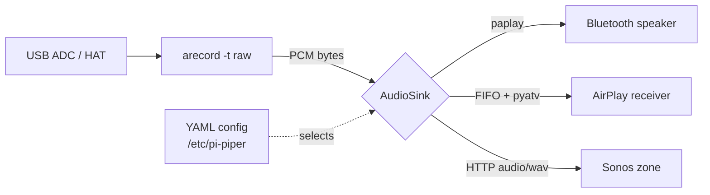

# pi-piper audit — 2026-10-19

Scope: full-repo review of the initial import (single commit `8c502f9`),
covering product purpose, architecture, top bugs/risks, and the highest-value
code improvements. Fixes landed on branch `omp/improve-2026-10-19`, one
focused commit per improvement; status is tracked at the bottom.

## Product purpose

pi-piper turns a Raspberry Pi / OrangePi with a USB ADC or audio HAT into an
analog-to-network audio bridge: it captures ALSA line-in audio and pipes it to
a Bluetooth speaker, an AirPlay receiver, or a Sonos zone. Ships as a CLI
(`pi-piper`) for setup/pairing plus a long-running daemon (`pi-piperd`)
installed as a systemd service; packaged for Debian/Ubuntu (deb) and
Arch/Manjaro (PKGBUILD).

## Architecture

~1.2k LOC of Python (3.10+, click + PyYAML at the core; soco/pyatv per
backend). Three layers:

- **CLI** (`cli.py`): click commands for config editing, device discovery,
  pairing, and systemd service control. Mutating commands load the YAML config,
  patch a field, and save it back.
- **Daemon loop** (`service.py:run`): installs signal handlers, then loops —
  start capture → start sink → poll both until one dies → stop both →
  exponential backoff (1s→30s) → restart. Missing binaries (`arecord`) are
  fatal; sink errors retry forever.
- **Pipeline**:
  - `audio/capture.py`: spawns `arecord -t raw` and exposes stdout as the PCM
    stream.
  - `sinks/base.py`: `AudioSink` interface (`start(pcm_stream)`, `stop()`,
    `is_alive()`).
  - `sinks/bluetooth.py`: `bluetoothctl` pairing + `paplay --raw` into the
    BlueZ sink PulseAudio/PipeWire exposes.
  - `sinks/airplay.py`: private FIFO + WAV header; a dedicated event-loop
    thread runs pyatv, which pulls the FIFO and streams it to the receiver.
  - `sinks/sonos.py`: in-process HTTP server fans captured PCM out to any
    number of listeners as `audio/wav`; `play_uri` tells the zone to pull it.

Config lives at `/etc/pi-piper/config.yaml` (system, installed by the
package) or `~/.config/pi-piper/config.yaml` (user), overridable with
`PI_PIPER_CONFIG`. The systemd unit pins both the config and the state dir
(`/var/lib/pi-piper`) via environment variables and runs as the `pi-piper`
user with `ProtectSystem=strict`.

## Top bugs / risks

Found by reading every source file; each is reproduced by inspection against
the cited code. Severity: **H** = wrong output or silent failure in the
primary use case, **M** = crash/data-loss footgun, **L** = robustness/UX.

1. **[H] AirPlay sink never reports death; errors are swallowed.**
   `sinks/airplay.py`. `start()` schedules `_start_async()` as a future
   (`:161`) whose exception is never read (the `_airplay_future` attribute is
   assigned there but never checked anywhere), and `is_alive()` (`:179`)
   returns "the loop thread is running" — which is true forever, because the
   loop thread only stops in `stop()`. Consequences: (a) if the target is not
   found, credentials fail, or the connection drops, the daemon logs nothing
   and keeps "running" with no audio, and the service.py restart/backoff logic
   never engages; (b) when `stream_file()` legitimately finishes, the pipeline
   is dead but never restarted; (c) `stop()` kills the loop without closing
   the pyatv connection (the coroutine's `finally: atv.close()` never runs if
   the loop is stopped first). This is the single biggest reliability gap.

2. **[H] Sonos broadcaster: data race and unbounded memory.**
   `sinks/sonos.py:_Broadcaster`. The pump thread appends to each
   subscriber's buffer under `self._lock` (`:96`), while HTTP handler threads
   do `chunk = b"".join(buf); buf.clear()` under the *condition* lock
   (`:130-131`) — two different locks guarding the same list. Joining while
   the pump appends is a race (torn reads), and `clear()` racing `append()`
   silently drops a chunk → audible glitches. Separately, a subscriber that
   stops reading (Sonos buffering stall, slow client) accumulates chunks with
   no cap: ~45 B/ms, so a stalled client leaks tens of MB/hour on a
   memory-tight Pi. Handler threads also never notice `stop()` and can hang
   on `cond.wait()` until the client disconnects.

3. **[H] Config load/save asymmetry silently discards changes.**
   `config.py:_resolve_config_path`. Load (`:95`) prefers the *system* config
   whenever it exists; save with `prefer_writable=True` prefers the *user*
   config whenever the system config isn't writable by the caller. Running a
   mutating CLI command without sudo (everything except the README's blessed
   path) therefore reads `/etc/pi-piper/config.yaml`, writes the change to
   `~/.config/pi-piper/config.yaml`, and the next load finds the system config
   first and ignores the user file. The user's change looks saved (the CLI
   says so) but never takes effect.

4. **[H] AirPlay credentials are never applied for any documented protocol
   name.** `sinks/airplay.py:117`: `getattr(pyatv.const.Protocol,
   proto.capitalize())` maps `raop` → `Raop`, `airplay` → `Airplay`, but the
   pyatv `Protocol` members are `RAOP` and `AirPlay`. The `AttributeError` is
   swallowed by a broad `except Exception` that only warns. The README
   troubleshooting recipe (`pi-piper airplay credentials raop <creds>`)
   therefore does nothing, and pairing-required receivers can never be made
   to work through pi-piper.

5. **[M] Configured sample format is ignored or misreported by every sink.**
   - Bluetooth (`sinks/bluetooth.py:151`): paplay is hard-coded
     `--format=s16le` regardless of `input.format`; capture at `S24_LE`/`S32_LE`
     makes the speaker play garbage at the wrong rate.
   - Sonos (`sinks/sonos.py:186`): `bits = 16 if fmt in {...} else 16` — a
     no-op ternary; the WAV header always claims 16-bit, so any other capture
     format produces corrupt audio.
   - AirPlay: the WAV header is hard-coded 16-bit (`sinks/airplay.py:_wav_header`).
   - The CLI (`cli.py:cmd_input_set`) accepts any `--format` string without
     validation or a hint about what the backends support.

6. **[M] `arecord` stderr is a pipe that nothing drains.**
   `audio/capture.py:81`. ALSA is chatty on warnings (unsupported rate
   falling back to a nearby one, softvol hints). If the pipe fills while the
   main thread is blocked waiting on the sink, `arecord` blocks writing
   stderr and capture stalls. Stderr should be inherited (it also surfaces
   real capture errors in the journal).

7. **[M] Uncaught `OSError` kills the daemon loop.** `service.py:run` catches
   `SinkError` and `FileNotFoundError` only. `OSError`s raised inside
   `sink.start()` — port already in use for the Sonos HTTP server
   (`EADDRINUSE`), spawn failures for `paplay` — propagate out of the retry
   loop and crash `pi-piperd` with a traceback. `Restart=on-failure` papers
   over it, but the backoff logic and log context are lost.

8. **[M] Signal handling raises exceptions in arbitrary frames.**
   `service.py:23` — `_install_signal_handlers` raises `_ShutdownRequest`
   from inside the handler. If the signal lands while the main thread is
   inside the cleanup `finally` (or a list operation), cleanup is interrupted
   mid-way: the Sonos zone keeps playing, `arecord`/`paplay` leak. An
   `threading.Event` the loop polls is the standard robust pattern.

9. **[L] Unknown config keys crash with a raw `TypeError`.**
   `config.py:_from_dict` splats YAML sections into dataclass constructors; a
   typo (`devices:` instead of `input:`) produces
   `TypeError: ... unexpected keyword argument` with no pointer to the file or
   key.

10. **[L] CLI tracebacks on missing system tools.** `pi-piper input list`
    raises `FileNotFoundError` (no `arecord`) and `pi-piper bluetooth scan` /
    `pair` / `connect` raise `SinkError` (no `bluetoothctl`) out of the
    command, dumping a traceback instead of a one-line error.

11. **[L] Packaging nits.** `pyproject.toml` package-data globs
    `data/systemd/*.service`, a path that does not exist in the package (the
    unit is installed by the deb/PKGBUILD rules, not the wheel — the glob is
    dead). `dbus-next` is a declared runtime dependency that nothing imports.
    The deb's hand-written `Depends` omits soco/pyatv (relies on
    `${python3:Depends}` mapping, which cannot provide pyatv on Debian —
    AirPlay/Sonos installs from the deb are under-specified).

### Risks (by design, accepted for now)

- **Sonos HTTP server binds `0.0.0.0`** — anyone on the LAN can pull the
  line-in stream (`/stream.wav`, no auth). Home-LAN trust model; binding to a
  specific interface would break multi-homed setups. Kept, documented here.
- **AirPlay/RIO WAV headers use `0xFFFFFFFF` sizes** — standard streaming-WAV
  hack; works with ffmpeg-backed receivers, may upset strict parsers.
- **Credentials stored in world-readable config** — addressed in the
  config-privacy fix (new user configs are created `0600`; existing file
  modes are left alone so the system config stays readable by the service
  user).

## Highest-value improvements (landed on `omp/improve-2026-10-19`)

Each item is one focused commit with targeted tests where a deterministic
contract exists. In order of value (commit hashes from
`git log omp/improve-2026-10-19 ^claude/audio-streaming-service-ygP49`):

1. **AirPlay: report death, surface errors, close connections.** Track the
   stream future; `is_alive()` is false once the stream task finishes or
   fails; failures are logged (this engages the daemon's restart/backoff);
   `stop()` cancels the task and waits for the coroutine to unwind so
   pyatv's `finally: atv.close()` runs before the loop stops. *(fixes 1;
   `3714b33`)*
2. **Sonos: race-free, bounded, shutdown-clean broadcaster.** One lock (the
   per-subscriber condition) guards each buffer; per-subscriber backlog is
   capped at 256 chunks (~6 s at 44.1 kHz stereo S16) with drop-oldest —
   for a live line-in, skipping stale audio beats unbounded lag/OOM; a
   `stopped` flag plus pump-exit notification lets handler threads drain
   and return on `stop()`. *(fixes 2; `c72e9ba`, tests)*
3. **Config: consistent load/save precedence.** Load order becomes
   env → existing user config → existing system config → user default. Save
   targets the same file it would load, falling back to the user config only
   when the system one isn't writable — and since the user file now wins on
   the next load, the round trip is coherent. The systemd unit pins
   `PI_PIPER_CONFIG`, so service behavior is unchanged. *(fixes 3;
   `8ffe730`, regression test verified failing pre-fix)*
4. **AirPlay: case-insensitive protocol-name → `Protocol` mapping.**
   `raop`/`airplay`/`mrp`/`companion` (any case) resolve to the pyatv enum;
   unknown names warn with the list of valid ones. *(fixes 4; `fae95d4`)*
5. **Audio formats honored end-to-end.** New helpers map ALSA format names to
   bit depth and paplay format strings; Bluetooth passes the mapped paplay
   format; Sonos and AirPlay refuse non-16-bit capture with a clear
   `SinkError` before any network/thread work (their WAV path is 16-bit only
   — chosen over adding an ffmpeg transcode stage); `pi-piper input set
   --format` validates against the known list. The two byte-identical private
   WAV-header builders were deduplicated into `formats.wav_header`.
   *(fixes 5; `0dda957`)*
6. **Service loop hardening.** `arecord` stderr inherited (no undrained-pipe
   stall; warnings reach the journal); `OSError` during sink start handled
   as a retryable sink error (`FileNotFoundError` stays fatal, exit 2;
   unknown backend exits 1); shutdown via `threading.Event` polled by the
   loop, with interruptible backoff sleeps. *(fixes 6, 7, 8; `cf065b0`,
   smoke-verified with a fake `arecord`: backoff retries, SIGTERM exits 0
   with no traceback)*
7. **Config robustness + privacy.** Unknown/ill-typed section keys are
   ignored with a warning pointing at the key instead of crashing with
   `TypeError`; newly created config files are `0600` (files under `/etc`
   stay `0644` so the service user can read them; existing modes are left
   alone). *(fixes 9, credential exposure in risks; `e42fbcc`, regression
   test verified failing pre-fix)*
8. **CLI: clean errors instead of tracebacks** for missing tools in
   `input list`, the bluetooth subcommands, and both scan commands.
   *(fixes 10; `35281a3`)*
9. **Packaging cleanup.** Drop the unused `dbus-next` dependency (pyproject +
   PKGBUILD); fix the dead `data/systemd/*.service` package-data glob; wheel
   rebuilt and contents verified. *(fixes 11, wheel side; `db06fd1`)*

### Decisions taken where the choice is normally Shay's

- **Sonos/AirPlay are 16-bit-only** (reject other formats with a clear error)
  rather than adding an ffmpeg transcode stage. Boring, honest, reversible.
- **Drop-oldest (cap 256 chunks)** instead of backpressure for slow Sonos
  HTTP clients.
- **`dbus-next` removed** from runtime deps (nothing imports it). If direct
  BlueZ D-Bus work is planned, it comes back with the code that needs it.
- **User config overrides system config** on load (XDG-style precedence),
  rather than erroring on non-sudo saves or ignoring user saves.
- **Kept:** `0.0.0.0` bind for the Sonos stream server (multi-homed
  robustness; LAN-trust model), streaming-WAV `0xFFFFFFFF` headers, existing
  config file permissions on rewrite.

### Not done (needs Shay or hardware)

- Deb dependency completeness for AirPlay/Sonos (pyatv/soco availability in
  Debian/Ubuntu repos) — packaging-distribution decision.
- End-to-end audio verification against real Bluetooth/AirPlay/Sonos
  hardware — no devices here; each fix was verified by targeted unit tests
  and code-path smoke runs (`pi-piper --help`, config round trips, ruff).

## Verification

35 targeted pytest cases (config precedence/round-trip/unknown keys/file
mode, WAV header layout + format mappings, broadcaster fanout/bounding/stop
wakeup, AirPlay protocol mapping) — all passing under Python 3.12 via uv;
regression tests for findings 3 and 9 were confirmed failing on the old code
with their original symptoms. `ruff check src tests` clean. Smoke runs
against the real CLIs: AirPlay sink liveness/stop (stream-task lifecycle on
a live event loop), Sonos HTTP path end-to-end with two concurrent clients
pulling the WAV stream, daemon loop error paths (unknown backend → exit 1,
missing arecord → exit 2, sink failure → backoff retry, SIGTERM → clean
exit 0), CLI error surfacing, format validation, and a wheel rebuild with
contents inspection. No hardware backends were exercised; those paths are
marked above.

## Follow-up pass (2026-10-19, same branch)

Two further code-only commits after the initial pass:

- `7888bd4` **fix(config): atomic saves and clear errors for corrupt YAML.**
  Corrupt config used to escape as a raw `yaml.ParserError` from every
  entry point; `load()` now raises `ConfigError` naming the file (CLI →
  one-line error, exit 1; `pi-piperd` → stderr + exit 1 before the restart
  loop). `save()` writes to a sibling `.tmp` and `os.replace()`s it in —
  a crash mid-write can no longer truncate the config or half-write
  credentials — and existing file modes carry across the replace. Tests:
  invalid-YAML contract (old code raised `ParserError`, confirmed), failed
  save leaves the original intact with no temp residue, mode
  preservation, empty file → defaults. Suite now at 39 cases.
- `e868032` **chore(dx): drop unused pytest-asyncio, document dev
  workflow.** Suite passes with it uninstalled; README gains a Development
  section with the uv setup used on this branch.
- `ef8778f` **fix(config): remove config knobs that were never honored.**
  `bluetooth.adapter` (stored but never passed to bluetoothctl), the
  unread `auto_reconnect` (the restart loop already reconnects) and
  `stream_codec` (WAV-only since the formats fix), plus the uncalled
  `AlsaCapture` context-manager methods. Old configs carrying them warn
  and are ignored; the example config is trimmed.
- `2471165` **fix(config): coerce hand-edited scalar types at load.**
  Wrong-typed YAML scalars (`target_mac: 12345`, `rate: '48000'`,
  `log_level: [1,2]`) used to reach runtime as-is and crash the daemon
  with TypeError/AttributeError — uncaught by the retry loop, i.e. a
  systemd crash-loop from a one-char hand-edit. The loader now coerces
  sane values to the declared type and falls back to defaults with a
  warning naming `section.key`. Suite now at 41 cases.
- `61e7970` **fix(capture): close stdout pipe on stop.** `Popen.wait()` does
  not close the PCM stdout object returned by `AlsaCapture.start()`, so
  repeated daemon restarts could retain one capture-pipe FD per generation
  until garbage collection. `stop()` now closes it in a `finally`, including
  terminate/kill paths; the targeted fake-arecord test verifies closure and
  idempotent cleanup.

Still parked (needs Shay or hardware):

- Deb dependency completeness for AirPlay/Sonos (pyatv/soco availability
  in Debian/Ubuntu repos) — packaging-distribution decision.
- End-to-end audio verification against real Bluetooth/AirPlay/Sonos
  hardware.
- Sonos `0.0.0.0` bind decision.
- **Multi-adapter Bluetooth (design sketch, parked by `ef8778f`).** bluez
  has no global `--adapter` flag; adapter selection is the per-process
  `select <controller>` command, so honoring the removed `adapter:` knob
  faithfully means rewriting `BluetoothCtl._run` to feed
  `select <adapter>\n<command>` scripts over bluetoothctl's stdin
  (including a timed scan session via Popen + stdin writes). Response
  strings ("Pairing successful", "Connected: yes") are unchanged between
  one-shot and scripted modes, but every parse path needs verification
  against a real bluetoothd, which this environment cannot provide.
- Remaining low-priority idea not pursued: stale AirPlay FIFO cleanup
  across pids (leaks a few bytes per crash; deletion risks a concurrent
  instance).
